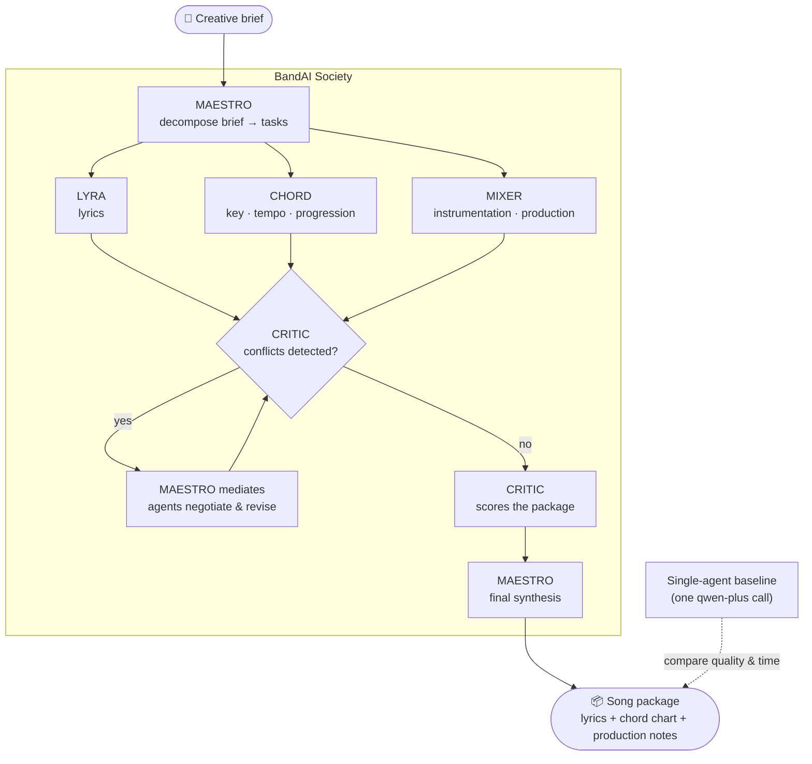

# BandAI 🎵

**A multi-agent music production society — five specialist Qwen agents that argue, negotiate, and write better songs together.**

[](LICENSE)
[](tsconfig.json)
[](https://www.alibabacloud.com/en/solutions/generative-ai/qwen)
[](#)

Music is collaborative. A songwriter, a theorist, a producer, and a critic each bring domain expertise — and they don't always agree. The tension between them produces better music than any one of them alone. BandAI models exactly that: five Qwen agents with distinct personas, real task division, explicit conflict detection, and negotiated resolution — plus a **single-agent baseline** so the multi-agent gain can be compared honestly.

Built by a working musician ([@creativeartistscorner](https://www.youtube.com/@creativeartistscorner)).

---

## Table of Contents

- [The Agents](#the-agents)
- [Architecture](#architecture)
- [How a Song Gets Made](#how-a-song-gets-made)
- [Multi-Agent vs Single-Agent](#multi-agent-vs-single-agent)
- [Quick Start](#quick-start)
- [Configuration](#configuration)
- [Project Structure](#project-structure)
- [License](#license)

---

## The Agents

| Agent | Role | Personality | In conflict with |
|---|---|---|---|
| 🎼 **MAESTRO** | Orchestrator | Structured, decisive, keeps the process moving | — (mediates) |
| ✍️ **LYRA** | Lyricist | Poetic, emotionally expressive, defends artistic choices | CHORD (structure) |
| 🎹 **CHORD** | Music theorist | Technical, precise, occasionally rigid | LYRA, MIXER |
| 🎛️ **MIXER** | Sound designer | Trendy, experimental, pushes boundaries | CHORD, LYRA |
| 🧐 **CRITIC** | Quality reviewer | Objective, sometimes harsh, always honest | — (evaluates all) |

Each agent is the same `qwen-plus` model steered by a distinct persona system prompt — same brain, different musicians.

## Architecture



## How a Song Gets Made

1. **Decompose** — MAESTRO turns the brief into concrete tasks per specialist.
2. **Specialists work in character** — LYRA writes lyrics; CHORD sets key, tempo, and progression; MIXER designs the sonic palette. Each defends its choices from its own persona.
3. **Conflict detection** — CRITIC reads all outputs against the brief and lists concrete disagreements (e.g. *LYRA's minor-key imagery vs CHORD's uplifting major key*).
4. **Negotiation** — MAESTRO mediates; conflicting agents revise with each other's argument in context (e.g. *borrowed bVI chord in the verse, major resolution in the chorus*). Revision counts are tracked per agent.
5. **Review & synthesis** — CRITIC scores emotional resonance, structure, and production fit; MAESTRO assembles the final package.

The result object includes the full paper trail: tasks, every specialist's output, detected conflicts, critic scores, iteration counts, and elapsed time.

## Multi-Agent vs Single-Agent

`singleAgentBaseline()` produces a song package from one un-personified `qwen-plus` call — same model, same brief. The demo runs both so you can compare quality and cost side by side.

> **Honesty note:** this repo makes no numeric quality claims. Judge the difference with your own ears (or your own raters) — the harness gives you both outputs and the timings to do so.

## Quick Start

**Prerequisites:** Node.js 18+, a [Qwen Cloud API key](https://www.alibabacloud.com/en/product/modelstudio).

```bash
git clone https://github.com/manojmallick/bandai.git
cd bandai
npm install

cp .env.example .env        # add your QWEN_API_KEY

npm run dev                 # full society + baseline on a sample brief
```

## Configuration

| Variable | Default | Purpose |
|---|---|---|
| `QWEN_API_KEY` | — (required) | Qwen Cloud API key |
| `QWEN_BASE_URL` | `https://dashscope.aliyuncs.com/compatible-mode/v1` | OpenAI-compatible endpoint |

The agent model defaults to `qwen-plus` (constructor parameter — one persona per call keeps five agents affordable).

## Project Structure

```
bandai/
├── src/
│   ├── index.ts        # personas, society pipeline, negotiation loop, baseline
│   └── qwenClient.ts   # Qwen Cloud client with robust JSON handling
└── README.md
```

## License

[MIT](LICENSE) © 2026 Manoj Mallick · Built for the Qwen Cloud Hackathon, Track 3 (Agent Society).
